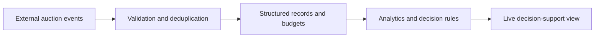

# FantaGiungla · Data Integration & Decision Support

**Problem:** In a fast-moving multi-participant auction, decisions require combining player information, current prices, budgets and a sequence of events without double-counting updates.

I have been developing a personal analytics platform using **Airtable** as a structured data layer, event ingestion from a separate auction interface, scenario-based price limits and decision-support views. **Predictive machine learning is being developed**, not presented as a validated result.

## Conceptual data flow



The diagram is a conceptual representation of the work, **not** proof that all private integrations are production-ready.

## Inspectable evidence

The [synthetic event-processing script](public_event_demo.py) illustrates input validation, retries, duplicate detection, leading bids, budget constraints and purchase updates. [Unit tests](../../tests/test_public_portfolio.py) cover invalid data and conflicting replays.

```bash
python projects/03-fantagiungla/public_event_demo.py
```

**What is not published:** live auction data, account identities, API tokens, invitation URLs, real player/participant details, vendor website code and the source of the private integration. This script is **an independently developed demonstration**, not an exported component of the working Airtable workflow.
