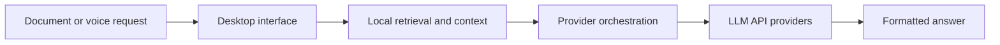

# Nova · AI Desktop Application & API Integration

**Problem:** Make it easier to work with documents and spoken requests in a single desktop interface while handling failed or slow external AI services.

Nova is a **personal Electron/Node.js desktop project** integrating LLM APIs (Gemini and Groq), local document retrieval, speech transcription, streaming responses, provider fallback and mathematical text rendering.

## Conceptual application architecture



## Inspectable evidence

- [Offline JavaScript fallback demonstration](mock_provider_demo.cjs): validates input and response content, tries a backup provider and fails closed when neither works.
- [Node.js tests](mock_provider.test.cjs): first-provider failure and invalid/empty response scenarios.

```bash
node --test projects/04-nova/mock_provider.test.cjs
```

The **public code is mocked and makes no external API calls**; it is not the original Electron application or a latency benchmark. The actual project has broader functionality than this small illustration. The full source, configuration, user documents and voice recordings are withheld pending security and redistribution review. This portfolio describes transparent, consent-based productivity use, not concealed real-time assistance in evaluations.
