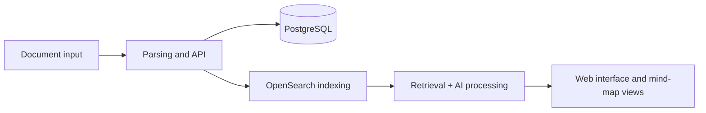

# PaperLens · Research Document Analysis (Open-Source Adaptation)

**Problem:** Explore how complex research documents can be indexed, searched and converted into structured outlines for review and presentation.

This project involved configuring, testing and modifying an **existing open-source PaperLens application**, rather than independently authoring its entire system. The original code is attributed to [Hridaya Sharma's PaperLens repository](https://github.com/hridaya14/PaperLens), distributed under the original project's MIT license.

## Components involved

Docker Compose coordinated the relevant local services, including Python/FastAPI, a web front end, PostgreSQL, Redis and OpenSearch. My work and experiments concerned the integrated workflow, troubleshooting and structured mind-map output for an academic document. The archived acceptance scripts include assertions about service health, indexing, mind-map structure and document-based responses; **their existence alone does not prove a successful final end-to-end run**.

## What is public

Only this technical case study and the upstream attribution. The source archive is excluded because of environment files, backups, embedded repository history and unresolved source-diff/redistribution questions. No private documents, original source ZIP or live credentials are distributed. This is an **open-source adaptation**, not a claim of sole authorship.
